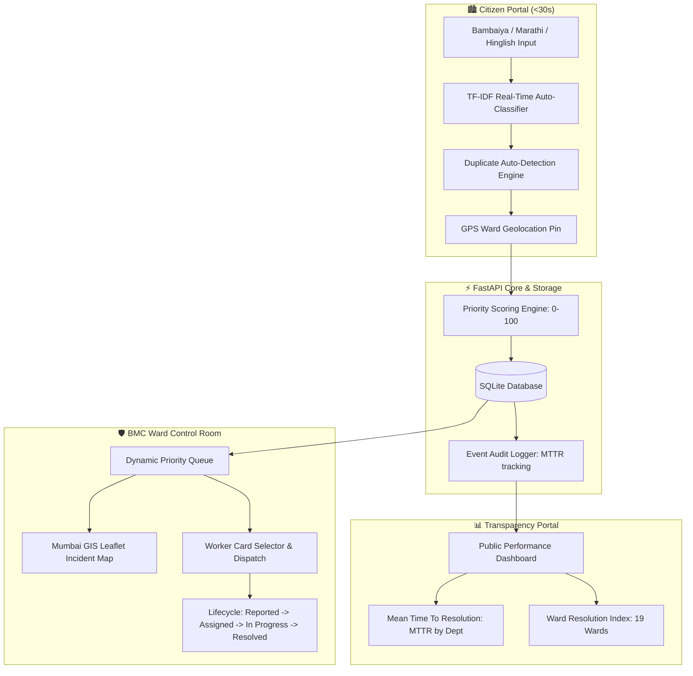

# BMC-Track AI — Brihanmumbai Civic Grievance & Response System (BMC / MCGM)

[](#-docker-deployment)
[](#-technology-stack)
[](#-technology-stack)
[](#-bambaiyahinglish-ml-classifier)
[](https://opensource.org/licenses/MIT)

---

## 📌 Project Overview

**BMC-Track AI** is an intelligent municipal civic grievance reporting, automated triage, and public transparency platform built for the **Brihanmumbai Municipal Corporation (BMC / MCGM)** across all **19 Administrative Wards** of Mumbai.

### 🎯 Motivation Context
In a megacity like Mumbai with over 13 million residents, urban hazards such as monsoon waterlogging, hazardous potholes on arterial roads, water pipeline bursts, sanitation choke-ups, and overflowing waste bins require rapid intervention. **BMC-Track AI** bridges the gap between Mumbaikars and BMC Ward Control Rooms with an end-to-end operational loop:

$$\text{Citizens Report} \longrightarrow \text{BMC Wards Dispatch} \longrightarrow \text{Performance is Measurable}$$

---

## 🏗️ System Architecture



---

## 📱 Three Integrated Views & Portals

### 1. 🏁 Portal Selection Landing Page
- Directs users to either the **Mumbaikar Citizen Portal** or the **BMC Ward Control Room**.

### 2. 📲 Citizen / Volunteer Reporting Portal
- **Target**: Submit a municipal issue in under **30 seconds**.
- **Features**:
  - Accepts free-form complaint text typed in **Bambaiya Hindi**, Marathi, Hinglish, or English (e.g., *"Colaba Causeway ke paas bada pothole hai bikes gir rahe hain please repair immediately"*).
  - **Real-Time ML Auto-Classification**: Automatically detects category & department as the user types with $<5\text{ms}$ latency.
  - **19 BMC Administrative Wards GPS Pin**: Dropdown and coordinate simulator across all 19 Mumbai wards.
  - **Duplicate Complaint Auto-Detection**: Flags and merges duplicate reports in the same ward into existing open tickets and automatically boosts their priority score (+15 points per duplicate report).
  - **Photo Evidence Simulator**: Optional photo upload.

### 3. 🛡️ BMC Ward Control Room (Admin System)
- **Target**: Operational dispatch queue for BMC Ward Officers and Sub-Engineers sorted by dynamic priority score ($0 - 100$).
- **Features**:
  - Filter queue by status (`reported`, `assigned`, `in_progress`, `resolved`), BMC Ward (19 wards), and minimum priority score.
  - **Interactive Mumbai Leaflet Map**: Displays incident markers across Mumbai, color-coded by priority score.
  - **Worker Detail Cards Selector**: Interactive card grid showing BMC field engineer name, phone, ward, status, and active task load.
  - **Lifecycle Actions**: Transition state from `assigned` $\rightarrow$ `in_progress` $\rightarrow$ `resolved`.
  - **In-App Reset Feature**: "Reset to 10 Demo Complaints" button to restore a clean, focused demonstration queue.

### 4. 📊 Public Civic Grievance & Transparency Portal
- **Target**: Public aggregate performance analytics without exposing personal data.
- **Features**:
  - **Mean Time To Resolution (MTTR)**: Interactive Recharts visualizations breaking down average resolution hours by BMC department and ward.
  - **Data Privacy Guarantee**: **Zero individual complainant text or personal phone numbers exposed**.
  - **Synthetic Data Lineage Badge**: Honest disclosure indicator displaying `is_synthetic = true` demo data percentage.

---

## 🧠 Bambaiya/Hinglish ML Classifier

Uses a fast, explainable `scikit-learn` `TfidfVectorizer` + `LogisticRegression` pipeline trained on realistic complaints across 5 core BMC categories:

| Category | Assigned Department | Priority Weight | Example Bambaiya/Hinglish Complaint |
|---|---|---|---|
| `pothole_road_damage` | Roads & Traffic Dept | 40 | *"Colaba Causeway road pe bada pothole hai gaadi gir sakti hai please repair karo"* |
| `waterlogging_blocked_drain` | Stormwater Drains (SWD) Dept | 38 | *"Hindmata Dadar underpass completely waterlogged cars stuck in heavy rain"* |
| `no_water_pipeline_leak` | Hydraulic Engineer (Water Supply) | 35 | *"Andheri East Saki Naka main water pipeline burst clean drinking water wasting on road"* |
| `toilet_sanitation_choke` | Public Health & Sanitation Dept | 30 | *"Mahim West near railway station public toilet completely choked and overflow"* |
| `garbage_overflow` | Solid Waste Management (SWM) Dept | 25 | *"Bandra Bandstand seaface road dustbins overflowing garbage spread everywhere"* |

### 📈 Evaluated Performance Metrics (80/20 Held-Out Test Split)
- **Exact Classification Accuracy**: **96.00%**
- **Macro F1 Score**: **96.00%**
- **Inference Latency**: $< 5\text{ms}$ (CPU only, zero GPU required)

---

## ⚖️ Transparent Priority Scoring Formula

Priority is computed deterministically ($0 - 100$) using a weighted rule-based formula:

$$\text{Priority Score} = \min\left(100,\, \text{SeverityWeight} + \text{PendingHoursFactor} + \text{WardClusterFactor}\right)$$

1. **Category Severity Weight** (Max 40 pts): `pothole_road_damage` (40), `waterlogging_blocked_drain` (38), `no_water_pipeline_leak` (35), `toilet_sanitation_choke` (30), `garbage_overflow` (25).
2. **Pending Time Factor** (Max 30 pts): $2.5 \times \text{Hours Elapsed}$
3. **Ward Cluster Density & Duplicate Factor** (Max 30 pts): $4.0 \times \text{Open Complaints in Ward} + 15 \times \text{Duplicate Reports}$

---

## 📍 19 BMC Administrative Wards Covered

| Zone | Ward Code | Ward Name & Coverage |
|---|---|---|
| South Mumbai | `WARD-A` | Ward A (Colaba, Fort & Marine Drive) |
| South Mumbai | `WARD-C` | Ward C (Bhuleshwar & Marine Lines) |
| South Mumbai | `WARD-D` | Ward D (Malabar Hill & Grant Road) |
| South Central | `WARD-E` | Ward E (Byculla & Mazgaon) |
| South Central | `WARD-F-SOUTH` | Ward F/South (Parel & Sewri) |
| South Central | `WARD-F-NORTH` | Ward F/North (Matunga, Sion & Wadala) |
| South Central | `WARD-G-SOUTH` | Ward G/South (Worli & Lower Parel) |
| Central Mumbai | `WARD-G-NORTH` | Ward G/North (Dadar, Mahim & Dharavi) |
| Western Suburbs | `WARD-H-WEST` | Ward H/West (Bandra West & Khar) |
| Western Suburbs | `WARD-H-EAST` | Ward H/East (Bandra East & Santacruz East) |
| Western Suburbs | `WARD-K-WEST` | Ward K/West (Andheri West, Juhu & Versova) |
| Western Suburbs | `WARD-K-EAST` | Ward K/East (Andheri East, Saki Naka & Marol) |
| Western Suburbs | `WARD-P-SOUTH` | Ward P/South (Goregaon) |
| Western Suburbs | `WARD-P-NORTH` | Ward P/North (Malad) |
| Western Suburbs | `WARD-R-SOUTH` | Ward R/South (Kandivali) |
| Western Suburbs | `WARD-R-CENTRAL` | Ward R/Central (Borivali) |
| Eastern Suburbs | `WARD-L` | Ward L (Kurla & Sakinaka Link) |
| Eastern Suburbs | `WARD-N` | Ward N (Ghatkopar & Vidyavihar) |
| Eastern Suburbs | `WARD-T` | Ward T (Mulund & Nahur) |

---

## 🔐 Default Credentials (BMC Ward Control)

| Role | Email | Password |
|---|---|---|
| BMC Admin / Commissioner | `admin@mcgm.gov.in` | `Admin@123` |
| BMC Ward Officer | `ward.officer@mcgm.gov.in` | `Ward@123` |
| Field Staff | `staff@mcgm.gov.in` | `Staff@123` |

---

## 🐳 Docker Deployment

Run the complete application (Frontend + Backend + SQLite + Demo Dataset) using **Docker Compose**:

```bash
docker compose up --build
```

To stop containers:
```bash
docker compose down
```

- **Web Application**: [http://localhost:3000](http://localhost:3000)
- **FastAPI Swagger Docs**: [http://localhost:8000/docs](http://localhost:8000/docs)

---

## 💻 Manual Local Setup

```powershell
# 1. Backend (FastAPI)
cd backend
python -m pip install -r requirements.txt
python -m uvicorn app.main:app --reload --port 8000

# 2. Frontend (React + Vite)
cd frontend
npm install
npm run dev
```
Open [http://localhost:3000](http://localhost:3000) in your browser.

---

## 📜 Architectural Decision Log (`DECISIONS.md`)

Key technical decisions and trade-offs are logged in [`DECISIONS.md`](DECISIONS.md) and viewable directly in the web app via the top navbar button.

---

## 📄 License
Released under the MIT License. Developed for the Brihanmumbai Municipal Corporation (BMC / MCGM) Civic Response Initiative.
